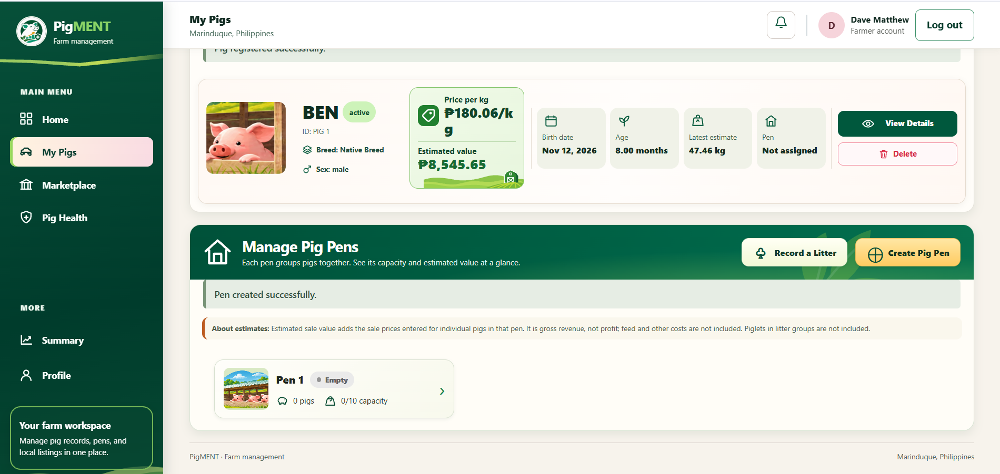
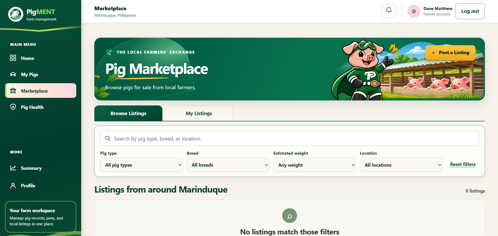
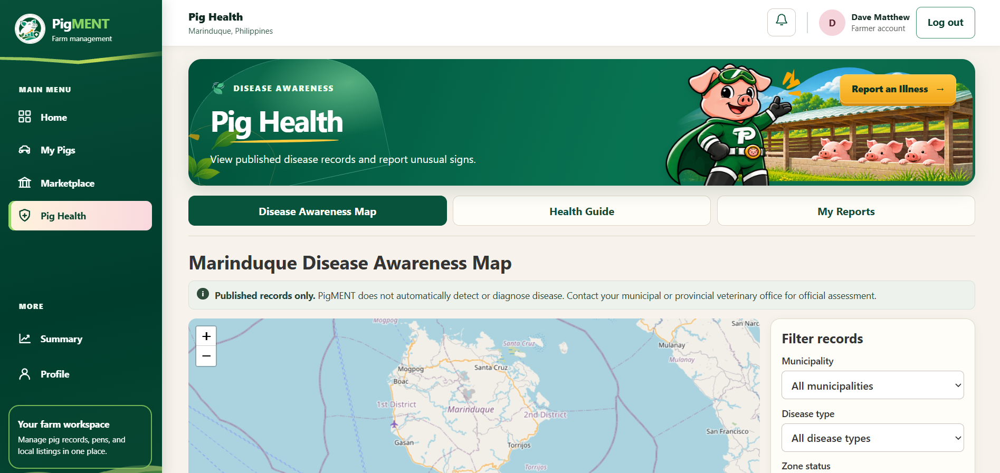

# PigMENT: A Web-Based Swine Growth Monitoring, Marketplace, and Disease Awareness System for Small-Scale Pig Farmers in Marinduque

**Authors:** Dave Matthew O. Laman, Kristhan Amir Jinrex L. Lope, Lord Byron H. Saguid, Ashleigh M. Mahaguay, and Tristan Jonnel S. Garcia  
**Affiliation:** BSIT 3C · Marinduque State University  
**Group:** Buttercocobonia · **Sector:** Agriculture & Food Innovation

[Manuscript PDF](docs/final-manuscript.pdf) · [Setup instructions](README.md#run-locally-with-xampp)

This Markdown version follows the supplied manuscript. Tables have been reformatted for GitHub. See the submission checklist accompanying this package for items the group still needs to reconcile.

## Abstract

Small-scale pig farmers in Marinduque need practical ways to maintain livestock records, estimate live weight when weighing scales are unavailable, share pigs for sale, and access disease-related information. This project developed PigMENT, a web-based system that brings these functions together. The team used an iterative and incremental development approach and built the system with HTML, CSS, JavaScript, PHP, and MySQL. Its three core features are pig growth monitoring and weight estimation, a community livestock marketplace, and pig health information with geographic disease awareness. During functional testing, the system generated live-weight estimates from heart girth and body length, displayed growth records, and supported pen assignments and transfers. The marketplace allowed users to create, search, filter, and view livestock listings. The disease awareness feature accepted suspected disease reports with location details, supported administrative review, and displayed approved disease information on an interactive map. These results showed that the three core workflows operated as intended under the conditions tested. However, the evaluation did not establish the accuracy of weight estimates against scale readings or the system’s effectiveness in actual farming operations. PigMENT supports disease awareness and reporting but does not diagnose disease or independently confirm cases.

**Keywords:** agriculture and food innovation, livestock marketplace, web-based system, swine growth monitoring, disease awareness

## I. Introduction

### 1.1 Background and Problem Context

In Marinduque, the swine industry faces production and market-related challenges that affect local pig farmers and the province's pork supply. The provincial government of Marinduque reported rising pork prices and declining pork supply in the province. The report identified high animal feed costs, increasing production expenses, and the recent African Swine Fever (ASF) outbreak as factors affecting local hog production. In response, the provincial government coordinated with stakeholders in the pork supply chain to develop measures addressing these concerns. These developments highlight the existing challenges within Marinduque's swine industry and the importance of supporting local pig farmers [18]. Furthermore, a study on Philippine native pigs demonstrated the potential of using external body measurements, particularly heart girth and body length, to estimate liveweight [1]. This supports the possibility of providing small-scale farmers with an accessible method of monitoring pig growth, especially when weighing scales are not readily available.

Disease prevention and awareness are also important concerns in Marinduque's swine industry. The Marinduque Provincial Veterinary Office strengthened ASF monitoring at the province's ports following suspected cases in nearby provinces. The provincial government also implemented restrictions on the entry of live pigs and pork products to help protect the province's ASF-free status. These preventive measures emphasize the importance of accessible and reliable disease information for pig farmers, barangay officials, and agricultural authorities.

Although existing reports and studies establish challenges affecting Marinduque's swine industry and smallholder pig production in the Philippines, the specific digital recordkeeping, livestock marketing, and disease information needs of small-scale pig farmers in Marinduque have not yet been sufficiently established. This research gap highlights the need for local assessment to determine how these concerns affect farmers throughout the province.

To address these potential needs, the proposed PigMENT system is a web-based platform designed to support pig growth monitoring, digital pen and livestock record management, community livestock listings, and access to pig health information and geographically presented disease reports. The system will be evaluated to determine its usability and acceptability as a digital management and information tool for small-scale pig farmers in Marinduque.

### 1.2 Problem Statement and Research Gap

Small-scale pig farmers need to monitor pig growth, maintain farm records, estimate selling prices, and access information that can support their farming activities. However, estimating the live weight of pigs may be challenging when weighing scales are not readily available. Most farmers rely on ‘eyeball’ estimation to market pigs. Previous studies have shown that external body measurements, such as heart girth and body length, can be used to estimate pig live weight. Other studies have also explored digital tools for organizing pig records and monitoring livestock information, demonstrating how technology can support swine farm management [1], [2], [5], [7], [11], [20].

Access to market information is another important consideration in livestock production. Existing studies provide a basis for considering an online marketplace where users can post livestock listings and view relevant information, such as breed, estimated weight, price, and location [4], [13], [14], [18]. Examined pig farmers’ biosecurity practices, disease awareness, and reporting of suspected African Swine Fever (ASF) cases, highlighting the importance of accessible disease information and appropriate reporting practices [6], [10], [15], [16], [17]. In Marinduque, government reports have discussed efforts to strengthen ASF monitoring and address concerns related to pork supply and hog production, showing the local relevance of livestock health and market coordination [3], [18].

Although existing studies and systems have addressed pig weight estimation, farm record management, agricultural marketplaces, and disease-related information, these functions are often examined or implemented separately. This presents an opportunity to develop a single platform that brings selected functions together for small-scale pig farmers. The specific research gap addressed by this project is the development of an integrated web-based system that combines pig growth monitoring, a livestock marketplace, and disease awareness features within the context of Marinduque. However, the reviewed literature and available government reports do not show how common these difficulties are among small-scale pig farmers throughout the province.

To address this gap, the project proposes PigMENT: A Web-Based Swine Growth Monitoring, Marketplace, and Disease Awareness System for Small-Scale Pig Farmers in Marinduque. The system will allow users to record pig information, estimate live weight using selected external measurements, track growth history, calculate estimated selling value, browse livestock listings, and access disease-related information and geographic awareness features. Reports of suspected disease cases will be subject to administrative review, and the system will not independently diagnose diseases or confirm outbreaks.

### 1.3 Objectives

To develop PigMENT, a web-based swine growth monitoring, marketplace, and disease awareness system designed to support small-scale pig farmers in Marinduque in managing pig growth information, accessing livestock listings, and obtaining disease-related information.

Specifically, this project aims to:

1. Develop a pig growth monitoring feature that allows users to record pig information, estimate live weight using selected external body measurements, track growth history, and calculate estimated selling value.
2. Develop a livestock marketplace feature that allows users to post, browse, and view livestock listings containing relevant details such as breed, age, estimated weight, asking price, and general location.
3. Provide a disease awareness feature that presents information about common swine diseases, ASF prevention, and biosecurity practices, along with geographic awareness information and a reporting feature for suspected disease concerns.
4. Implement a web-based database and user interface that organize pig records, marketplace listings, and disease-related information in one platform.
5. Test the core system functions to determine whether the implemented features work according to their intended requirements and identify limitations that may require improvement.

### 1.4 Proposed Solution, Scope and Limitations

PigMENT is a proposed web-based system for monitoring growth performance, marketplace activities, and disease awareness among small-scale and backyard pig farmers in Marinduque. The system will provide a centralized platform where farmers can maintain livestock information, monitor the estimated growth of their pigs, calculate potential selling values, find buyers, and access relevant livestock disease information. Existing web based livestock management systems have explored ways to support the monitoring of reproductive performance, diseases, and biosecurity in swine farms [10]. Web-based record-keeping applications have also demonstrated their potential to help native pig farmers organize and manage livestock information [20].

The system will focus on three main features. First, the pig growth monitoring and weight estimation feature will allow farmers to register their pigs and record information such as breed, age, sex, heart girth, and body length. These measurements will be used to estimate live weight and maintain a history of recorded growth data. Previous studies have examined the use of external body measurements, particularly heart girth and body length, to estimate pig live weight [1], [2], [8]. Farmers will also be able to enter a price per kilogram to estimate the potential selling value of their pigs.

Second, the community livestock marketplace will allow registered farmers to create livestock listings containing relevant information about their pigs, including estimated weight, age, asking price, and general location. Potential buyers will be able to browse available listings and contact sellers directly. Previous studies on agricultural marketplaces and livestock supply chain platforms have explored how digital platforms can connect agricultural producers with potential buyers and improve access to market information [4], [13], [14].

Third, the pig health information and geographic disease awareness feature will provide basic information about common pig health concerns, African Swine Fever (ASF), preventive measures, and biosecurity practices. Previous studies have examined biosecurity practices, disease recognition, and early reporting among smallholder pig farmers [6], [15], [16].

The study is limited to developing a web-based system intended for small-scale and backyard pig farmers in Marinduque. The system will rely on information manually entered by users and will not require specialized sensors or automated weighing equipment. Unlike systems that use wireless communication for pig growth monitoring [5].

The calculated live weight will serve only as an estimate as its accuracy depends on the selected estimation formula, the characteristics of the pig, and the accuracy of the measurements provided by farmers [1], [2], [8]. Reports submitted by farmers will undergo administrative review, and only authorized veterinary personnel will be able to identify cases as confirmed. These limitations will keep the proposed system focused on its three primary functions: livestock growth monitoring, community marketplace access, and disease awareness.

## II. Methodology

### 2.1 Development Approach

The development of PigMENT followed an iterative and incremental development approach, in which the system was developed and improved through successive implementations of its core features. The team initially created a frontend prototype using HTML, CSS, and JavaScript to establish the system's interface, navigation, and basic functionality. The initial implementation focused on pig registration and management, digital pig pens, and the community livestock marketplace.

As development progressed, the team reviewed and tested the implemented features to identify errors, incomplete functions, and areas requiring improvement. Modifications were made to improve usability, functionality, and consistency across the system. Additional components, including pig growth monitoring, disease reporting, geographic disease awareness, and user account management, were progressively developed. PHP and MySQL were subsequently introduced to support backend processing, user authentication, and persistent data storage. This approach allowed the team to develop the system in manageable components, evaluate existing functionality, and make necessary improvements while integrating additional features. Functional verification was conducted on implemented components to assess whether they performed their intended operations and satisfied the identified system requirements.

### 2.2 Requirements and Core Features

**Table 1. Requirements and Core Features**

| Problem or need | Core feature | Acceptance criterion |
| --- | --- | --- |
| Difficulty organizing pig farm records | Pig Growth Monitoring and Weight Estimation | Register and update pigs, estimate live weight from heart girth and body length, show growth history, manage pens and assignments, and record litter information. |
| Difficulty presenting livestock information and finding buyers | Community Livestock Marketplace | Create and manage listings containing pig information, estimated weight, asking price, and location. |
| Limited access to organized health information and reporting channels | Pig Health Information and Geographic Disease Awareness | Provide health and biosecurity information, accept reports with location details, and allow authorized administrators to review and update reports. |

### 2.3 Interface Architecture and Data Handling

PigMENT uses a web-based interface organized into three core features: Pig Growth Monitoring and Weight Estimation, Community Livestock Marketplace, and Pig Health Information and Geographic Disease Awareness. Additional interfaces include the dashboard, user profile, reports, and administrative management.

The system uses HTML, CSS, and JavaScript for interface design and user interactions, including form submissions, calculations, filtering, and navigation. PHP handles server-side processing and communicates with a MySQL database for persistent data storage, while JSON is used to exchange data between the frontend and backend. Leaflet and OpenStreetMap support geographic visualization. My Pigs displays recorded growth history. User access and data modifications are controlled through authentication and role-based permissions.

### 2.4 Technology Selection and Comparative Justification

**Table 2. Technologies and Justification**

The supplied PDF leaves the alternatives column blank. The following table records the technology and rationale. Add only alternatives the team actually considered.

| Technology | Reason for use in PigMENT | References as numbered in the supplied manuscript |
| --- | --- | --- |
| HTML5 | Structures the pages, forms, and other content. | [20], [26], [34] |
| CSS3 | Styles the forms and layouts and supports responsive presentation. | [20], [27], [35] |
| JavaScript | Handles interface interactions, calculations, filtering, and presentation of data. | [28], [34], [36] |
| PHP | Processes requests and connects the application to persistent storage. | [29], [34], [35] |
| MySQL | Stores related records for farm management, listings, and disease reporting. | [20], [30], [34] |
| Leaflet and OpenStreetMap | Present report locations and published zones on an interactive map. | [31], [32] |

The manuscript also lists Chart.js. The supplied final application source does not load Chart.js, and the My Pigs page presents growth history as records. Align §2.3, Table 2, and §2.5 of the source manuscript with the submitted build before final export.

### 2.5 Implementation and Evaluation Procedure

PigMENT system was created as a web-based system through use of HTML, CSS, JavaScript, PHP and MySQL, with disease mapping provided by Leaflet. The implementation of the system was done based on three major functions namely; Pig Growth Monitoring and Weight Estimation, Community Livestock Marketplace and Pig Health Information and Geographic Disease Awareness. In addition to this, functional testing involved the tests for the record management, weight estimation, community marketplace, disease reporting, administration and maps. The interface testing involved tests of the response of the system to various viewports and keyboard accessibility. The outcome of the test was recorded through use of screenshots and where problems existed, it was fixed and tested again.

## III. Results and Discussion

### 3.1 Core Feature 1: Pig Growth Monitoring and Weight Estimation

*Figure 1. Pig Growth Monitoring and Weight Estimation*

The Pig Growth Monitoring and Weight Estimation feature helps farmers organize pig records and monitor livestock growth. Users can register pigs, enter information such as breed, age, sex, heart girth, and body length, and obtain an estimated live weight and selling value. As shown in Figure 1, the interface also supports digital pen management, pig assignment and transfer, growth history, and litter records.

Functional testing confirmed that pig registration, weight estimation, growth tracking, pen management, and litter management worked as intended. However, estimated weights depend on the accuracy of the measurements provided by users.

### 3.2 Core Feature 2: Community Livestock Marketplace

*Figure 2. Community Livestock Marketplace*

The Community Livestock Marketplace provides a platform for farmers to advertise their livestock and connect with potential buyers. Users can post listings containing pig details such as breed, age, estimated weight, asking price, and location. As shown in Figure 2, the interface includes browsing, searching, filtering, and listing management functions, with seller information available for each listing.

Functional testing confirmed that listing creation, management, searching, filtering, and viewing listing details worked successfully. However, the platform only facilitates connections between buyers and sellers and does not guarantee completed transactions.

### 3.3 Core Feature 3: Pig Health Information and Geographic Disease Awareness

*Figure 3. Pig Health Information and Disease Awareness*

The Pig Health Information and Geographic Disease Awareness feature provides farmers with information about common pig diseases, African Swine Fever (ASF), and biosecurity practices. As shown in Figure 3, users can access health guides, submit suspected disease reports with location details, and view verified disease-related information through an interactive map. The system also allows administrators to review reports and update their statuses.

Functional testing confirmed that health information, disease reporting, administrative review, and geographic mapping worked as intended. However, the system does not independently diagnose or confirm diseases; submitted reports require verification by authorized veterinary personnel.

### 3.4 Functional Verification and Limitations

**Table 3. Core Functional Features**

| Core feature | Expected behavior and observed evidence reported by the team | Status reported in the manuscript |
| --- | --- | --- |
| Pig Growth Monitoring and Weight Estimation | Pig registration and profiles recorded livestock information. Entered measurements produced estimates, growth records were displayed, and pen creation, assignments, transfers, and litter management were supported. | Passed |
| Community Livestock Marketplace | Listings were created and displayed. Search and filtering returned matching listings, and the details view showed the pig information, price, location, and seller details. | Passed |
| Pig Health Information and Geographic Disease Awareness | Health and biosecurity information was accessible. Reports with location details were submitted and reviewed, and approved disease information was shown on the map. | Passed |

These are the functional results reported in the manuscript for the scenarios tested. They do not establish field usability, weight accuracy against a scale, or independent disease confirmation.

## IV. Conclusion

PigMENT was developed as a web-based system that brings together livestock recordkeeping, local marketplace listings, and disease awareness for small-scale pig farmers in Marinduque. The system allows farmers to register pigs, manage pens and litter records, and track estimated live weight over time using heart girth and body length measurements. A separate calculator estimates live weight and potential selling value without requiring users to register a pig. The marketplace lets farmers post and manage livestock listings and lets prospective buyers search, filter, and view listing details before contacting sellers directly. The pig health module provides educational information and allows farmers to submit suspected disease reports with location details. Administrators can review these reports, and the public map displays only published incidents and zones that meet the system’s confirmation requirements. The functional checks documented in Section 3.4 showed that the three core workflows performed as expected in the scenarios tested.

These capabilities provide farmers with one place to maintain livestock records, share sale information, and access disease updates. However, the functional checks did not establish how closely the weight estimates match actual scale readings or how well PigMENT fits farmers’ daily routines. The marketplace does not process payments, and the disease module does not diagnose illness or independently confirm cases. Future work should compare estimated and measured weights for pigs of different sizes, test the system with local farmers using their own devices and internet connections, and consult local veterinary personnel about how the reporting and publication workflow could fit existing practices.

## References

[1] E. P. Paras and R. K. S. Cu-Cordoves, “Estimating liveweight of Philippine native pigs using external body measurements,” Philippine Journal of Veterinary and Animal Sciences, vol. 40, no. 1, pp. 47–52, 2014.

[2] K. Marshall, J. Poole, E. Oyieng, E. Ouma, and D. R. Kugonza, “A farmer-friendly tool for estimation of weights of pigs kept by smallholder farmers in Uganda,” Tropical Animal Health and Production, vol. 55, Art. no. 219, 2023, doi: 10.1007/s11250-023-03561-z.

[3] K. Lansangan, “Provincial Vet tightens ASF monitoring at Marinduque ports,” Philippine Information Agency, Sept. 23, 2026.

[4] S. Gadhve, U. Rudrakar, S. Vairagade, P. A. K. Kale, and A. Jawade, “An intelligent agriculture marketplace for farming and e-commerce integration,” in Proc. 2025 4th OPJU International Technology Conference (OTCON) on Smart Computing for Innovation and Advancement in Industry 5.0, 2025, doi: 10.1109/OTCON65728.2025.11071090.

[5] X. Shipu, W. Yunsheng, H. Wenwen, W. Yingjing, and L. Yong, “Design and implementation of pig growth monitoring system based on wireless communication,” in Proc. 2020 IEEE 3rd International Conference on Computer and Communication Engineering Technology (CCET), Beijing, China, 2020, pp. 239–243, doi: 10.1109/CCET50901.2020.9213123.

[6] D. T. C. Bernardes and S. T. Peña Jr., “Biosecurity and readiness of smallholder pig farmers against potential African Swine Fever outbreak and other pig diseases in Baybay City, Leyte, Philippines,” Scientia Agropecuaria, vol. 11, no. 4, pp. 611–620, 2020, doi: 10.17268/sci.agropecu.2020.04.17.

[7] A. A. Firdaus, “Web-based monitoring and management system for livestock operations,” JOSAPEN, vol. 3, no. 2, pp. 46–51, Aug. 2025, doi: 10.70356/josapen.v3i2.69.

[8] F. Mutua, C. Dewey, S. Arimi, E. Schelling, and W. Ogara, “Prediction of live body weight using length and girth measurements for pigs in rural Western Kenya,” Journal of Swine Health and Production, 2011, doi: 10.54846/jshap/651.

[9] R. Ramos, L. Darog, S. I. Openiano, V. A. Pitogo, C. C. Abalorio, and J. F. Rusdi, “Livestock management platform: An agile web-based agricultural solution,” in Proc. 2025 8th International Conference on Information and Computer Technologies (ICICT), Hilo, HI, USA, 2025, pp. 338–343, doi: 10.1109/ICICT64582.2025.00059.

[10] J. C. Salazar, N. C. Tanquilut, P. M. S. Torres, M. N. M. Muñoz, and J. T. Dingle, “Development of a web-based information system for surveillance of reproductive performance, diseases and biosecurity in swine farms in Pampanga,” Philippine Journal of Veterinary and Animal Sciences, vol. 51, no. 2, pp. 59–69, 2025.

[11] J. C. Lee, E. B. Lañada, S. J. More, B. S. Cotiw-an, and A. A. Taveros, “A longitudinal study of growing pigs raised by smallholder farmers in the Philippines,” Preventive Veterinary Medicine, vol. 70, nos. 1–2, pp. 75–93, 2005, doi: 10.1016/j.prevetmed.2005.02.016.

[12] C. G. Calma and J. M. J. Bawagan III, “PigPal: A mobile application for smallhold swine management,” Institute of Computer Science, University of the Philippines Los Baños, 2025.

[13] G. L. Intal and T. D. Palaoag, “Redesigning the swine industry supply chain: A B2B e-marketplace platform,” in Proc. 2023 International Conference on Software and System Engineering (ICoSSE), 2023, pp. 57–62, doi: 10.1109/ICoSSE58936.2023.00018.

[14] C. Conde, R. Maaño, H. S. Santonil, D. N. Canela, and R. Maaño, “AgriMarket Hub: Online agricultural marketplace platform,” IOP Conference Series: Earth and Environmental Science, vol. 1572, no. 1, Art. no. 012065, 2025, doi: 10.1088/1755-1315/1572/1/012065.

[15] S. M. S. Wheless and H. P. Portugaliza, “Disease recognition and early reporting of suspected African swine fever in Baybay City, Leyte, Philippines: A KAP study,” NRCP Research Journal, vol. 22, no. 2, 2023.

[16] “Understanding the knowledge, attitudes, and practices of stakeholders in reporting African swine fever cases in Abuyog, Leyte, Philippines,” Journal of Advanced Veterinary and Animal Research, 2025, doi: 10.5455/javar.2025.l927.

[17] G. D. Bulawit, T. D. Palaoag, and B. Bulawit, “Designing PIGSAFE: Pig Industry Geographic Surveillance and Assessment for Fever Emergencies Against African Swine Fever,” International Journal of Experimental Research and Review, vol. 47, 2025, doi: 10.52756/ijerr.2025.v47.001.

[18] D. C. Nebrejo, “Marinduque gov’t eyes multi-sectoral solutions to stabilize pork supply,” Philippine Information Agency, Feb. 5, 2026. [Online]. Available: https://pia.gov.ph/news/marinduque-govt-eyes-multisectoral-solutions-to-stabilize-pork-supply/

[19] T. S. Barnes et al., “Combining conventional and participatory approaches to identify and prioritise management and health-related constraints to smallholder pig production in San Simon, Pampanga, Philippines,” Preventive Veterinary Medicine, vol. 178, Art. no. 104987, May 2020, doi: 10.1016/j.prevetmed.2020.104987.

[20] K. M. Abriol-Santos, L. U. Ual, K. U. Aquino, R. M. B. Jamisola, and C. A. S. Estrella, “The Philippine native pig breed information system: A web-based record keeping application for native pig farmers,” Philippine Journal of Veterinary and Animal Sciences, vol. 48, no. 1, pp. 33–40, 2022.

[21] E. B. Lagua, H.-S. Mun, M. Sharifuzzaman, M. K. Hasan, A. Mehtab, J.-G. Kang, H.-R. Park, Y.-H. Kim, and C.-J. Yang, “Toward intelligent pig farming: Advancing health and welfare monitoring through computer visionbased behavioral analysis,” Computers and Electronics in Agriculture, vol. 254, Art. no. 112210, Nov. 2026, doi: 10.1016/j.compag.2026.112210.

[22] S. G. Matthews, A. L. Miller, T. Plötz, and I. Kyriazakis, “Automated tracking to measure behavioural changes in pigs for health and welfare monitoring,” Scientific Reports, vol. 7, Art. no. 17582, 2017, doi: 10.1038/s41598- 017-17451-6.

[23] Y. Zhang, “From platform provider to big-data-enabled financier: Industrial upgrading in China’s hog sector,” Big Data & Society, vol. 12, no. 3, pp. 1–13, Jul.–Sep. 2025, doi: 10.1177/20539517251367445.

[24] G. Papadopoulos, M.-Z. Papantonatou, H. Uyar, O. Kriezi, A. Mavrommatis, V. Psiroukis, A. Kasimati, E. Tsiplakou, and S. Fountas, “Economic and environmental benefits of digital agricultural technological solutions in livestock farming: A review,” Smart Agricultural Technology, vol. 10, Art. no. 100783, 2025, doi: 10.1016/j.atech.2025.100783.

[25] J. B. Flores, “Development of a web-based GIS simulator for real-time modeling of African swine fever spread,” Tra Vinh University Journal of Science, 2024, doi: 10.35382/tvujs.14.8.2024.74.

[26] WHATWG, “HTML Living Standard,” Web Hypertext Application Technology Working Group. [Online]. Available: https://html.spec.whatwg.org/multipage/. [Accessed: Nov. 5, 2026].

[27] World Wide Web Consortium (W3C), “CSS Snapshot 2026,” W3C. [Online]. Available: https://www.w3.org/TR/css/. [Accessed: Nov. 5, 2026].

[28] Mozilla Developer Network (MDN), “JavaScript Guide,” Mozilla. [Online]. Available: https://developer.mozilla.org/en-US/docs/Web/JavaScript/Guide. [Accessed: Nov. 5, 2026].

[29] The PHP Group, “PHP Manual,” PHP Documentation. [Online]. Available: https://www.php.net/manual/en/. [Accessed: Nov. 5, 2026].

[30] Oracle Corporation, “MySQL 8.4 Reference Manual,” MySQL Documentation. [Online]. Available: https://dev.mysql.com/doc/refman/8.4/en/. [Accessed: Nov. 5, 2026].

[31] V. Agafonkin, “Leaflet: An Open-Source JavaScript Library for Mobile-Friendly Interactive Maps,” Leaflet Documentation. [Online]. Available: https://leafletjs.com/reference.html. [Accessed: Nov. 5, 2026].

[32] OpenStreetMap contributors, “Copyright and License,” OpenStreetMap. [Online]. Available: https://www.openstreetmap.org/copyright. [Accessed: Nov. 5, 2026].

[33] Chart.js contributors, “Chart.js Documentation,” Chart.js. [Online]. Available: https://www.chartjs.org/docs/latest/. [Accessed: Nov. 5, 2026].

[34] S. Parisutthikul, S. Faarungsang, M. Duangjinda, and A. Thongpan, “Web-based Information System for Management of Swine Breeding Herd Farm,” Agriculture and Natural Resources, vol. 44, no. 3, pp. 471–484, 2010. [Online]. Available: https://li01.tci-thaijo.org/index.php/anres/article/view/244952.

[35] J. A. D. Manabat, K. B. B. Paris, K. U. Ramirez, and R. A. C. Malaborbor, “FAMS: Web-Based Monitoring System with 2D Mapping for Calamba City Agricultural Services Department,” Ani: Letran Calamba Research Report, vol. 3, no. 1, 2016. [Online]. Available: https://ejournals.ph/article.php?id=10841.

[36] T. Petukhova, M. Spinato, T. Rossi, M. T. Guerin, D. Kelton, P. Nelson-Smikle, M. Barham, D. Ojkic, and Z. Poljak, “Development of interactive dashboards for monitoring endemic animal pathogens in Ontario, Canada: Ontario interactive animal pathogen dashboards,” Journal of Veterinary Diagnostic Investigation, vol. 35, no. 6, 2023, doi: 10.1177/10406387231190076.

[37] G. Morota, H. Cheng, D. Cook, and E. Tanaka, “ASAS-NANP SYMPOSIUM: Prospects for interactive and dynamic graphics in the era of data-rich animal science,” Journal of Animal Science, vol. 99, no. 2, Art. no. skaa402, 2021, doi: 10.1093/jas/skaa402.

## CRediT Author Contributions Statement

| Member | CRediT role supported by the supplied files | Specific contribution or evidence |
| --- | --- | --- |
| Dave Matthew O. Laman | Software — confirm account attribution | The `lamandavematthew-create` commits `ff5d6c6` and `016d7b0` document the addition of the disease map and affected-zone functionality. |
| Kristhan Amir Jinrex L. Lope | Pending member confirmation | No contribution was assigned in the supplied CRediT table. Add verified work and its CRediT role. |
| Lord Byron H. Saguid | Software — confirm account attribution | The `ItsByron` commits `54a242f`, `ad48876`, `99e227c`, and `657bf9c` document authentication backend work, the admin dashboard, login and sign-up interface changes, and My Pigs updates. |
| Ashleigh M. Mahaguay | Software — confirm scope | Commit `5cf373e`, recorded as Ashleigh Mahaguay, updates formatting in `src/index.html`. Add any other verified contribution. |
| Tristan Jonnel S. Garcia | Pending member confirmation | Named in the byline and member confirmation but missing from the manuscript's CRediT table. Add verified work and its CRediT role. |

The supplied manuscript records all five names under the November 12, 2026 confirmation. Individual roles still require team confirmation. See [CONTRIBUTIONS.md](CONTRIBUTIONS.md).

## AI Use and Supporting Evidence

The group used GitHub Copilot for software development and interface refinement and ChatGPT for manuscript drafting and revision. The supporting records describe the tasks, affected sections or files, exact prompts, outputs used, validation methods, and responsible members where documented. See the [AI_DISCLOSURE.md](AI_DISCLOSURE.md) file in the PigMENT GitHub repository for the disclosure log and the accompanying CICS form.
